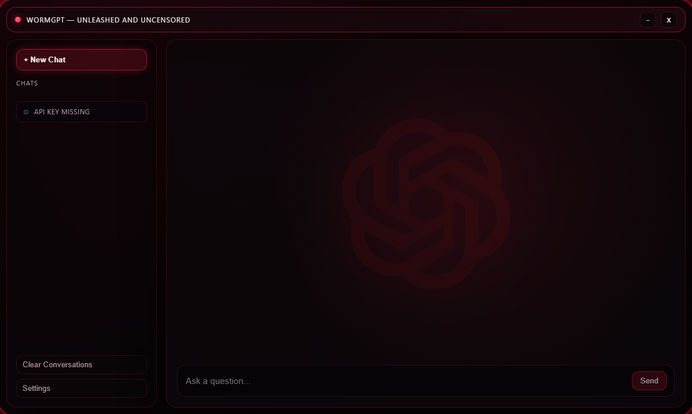

# WormGPT - Unleashed and Uncensored

WormGPT is a desktop chat client built with Electron + React and powered by the Groq API.

## Features
- Multi-chat sidebar with persistent history
- API key manager (save, test, revoke)
- Local chat storage
- Renderer bundle obfuscation (deterrent, not a guarantee)
- Optional GPU disable flag for troubleshooting
- Agent Controls foundation with explicit permissions, authorized directories, confirmations, and audit logging

## Screenshot
Place the screenshot at `assets/screenshot.png`.



## Requirements
- Node.js 18+ (LTS recommended)
- Windows 10/11 for installer builds

## Install
```sh
npm install
```

## Run (dev)
```sh
npm run start
```

## Build the renderer bundle
```sh
npm run build:renderer
```

## Build Windows EXE (installer + portable)
```sh
npm run dist
```

Outputs will be in `dist/`.

## GPU disable (optional)
PowerShell:
```powershell
$env:WORMGPT_DISABLE_GPU='1'; npm run start
```

Or pass a flag:
```sh
npm run start -- --disable-wormgpt-gpu
```

Disabling hardware acceleration forces CPU rendering. Use it if you see black
screens, crashes, or visual glitches caused by GPU drivers.

## Launcher (Windows)
`run-wormgpt.bat` lets you choose hardware acceleration on startup and then
builds the EXE (runs `npm install` and `npm run dist` if needed), then launches
the packaged app from `dist/win-unpacked` or `dist/`.
If a build already exists, it prompts to reuse it or rebuild.

## API key storage
Set your API key in Settings. It is stored locally at:
`%APPDATA%\\wormgpt\\wormgpt-data.json`

Use the Revoke button to remove it.

## Agent foundation

Open **Agent Controls** in the sidebar to configure the future tool layer. Phase 1
provides:

- Explicit operating modes and disabled-by-default permissions
- Authorized directory and trusted-directory configuration
- Confirmation policy for medium- and high-risk actions
- Secret-redacted audit logging
- A standard tool registry for future filesystem, browser, terminal, and research tools

Filesystem, browser, terminal, application-control, and computer-control tools are
not enabled by this foundation yet. They will be added behind these controls with
path checks, confirmation gates, timeouts, and audit entries rather than receiving
unrestricted operating-system access.


